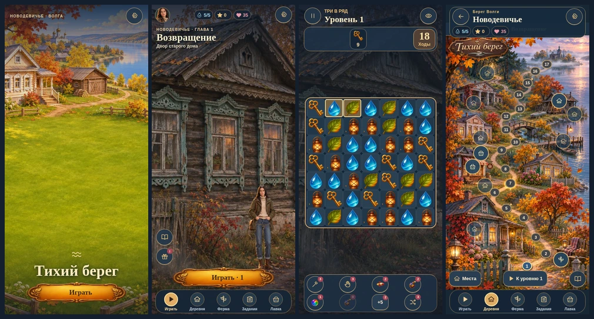
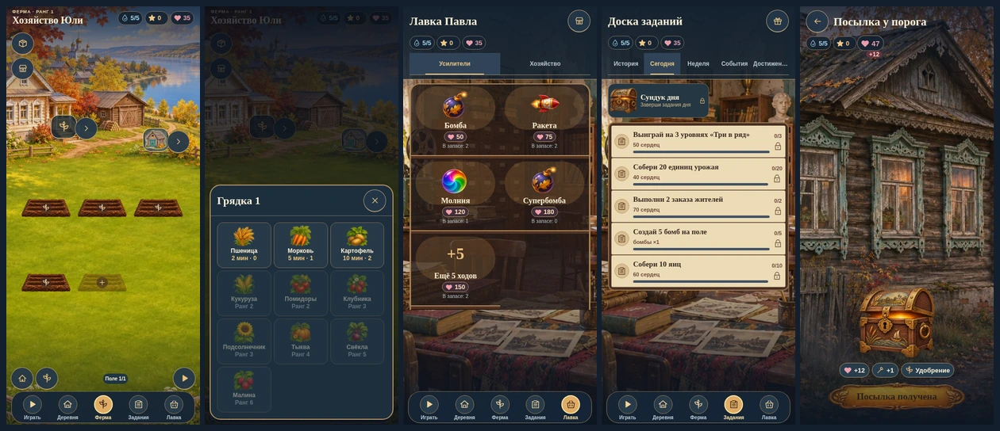
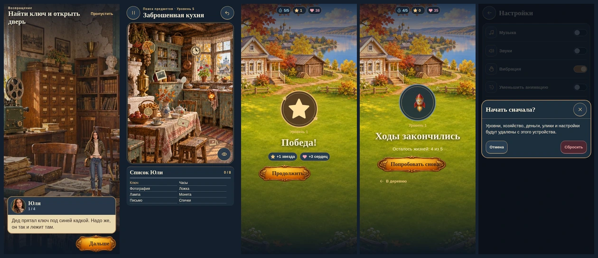

# Тихий берег · интерфейс 1.3.0

## Что изменилось

- Главное меню и дом Юли используют иллюстрации на весь экран. Валюты, дневник, посылка и настройки доступны поверх сцены. Название главы помещается в одну строку.
- В Match‑3 переработаны счётчики целей и ходов, рамка поля, панель усилителей, обучение, пауза и результаты. В поиске предметов подсказка доступна у сцены, а список и состояние поиска видны вместе.
- Карта Новодевичья получила компактные элементы управления, отдельное окно мест и кнопку возврата к текущему уровню.
- На ферме грядки и постройки размещены в сцене. Нажатие на свободную грядку открывает семена, на зрелую — собирает урожай. Кормление и сбор доступны у постройки. Склад, рынок, мастерские, строительство и украшения открываются поверх хозяйства.
- В лавке усилители показаны на полках с ценой и остатком. Задания собраны на доске с прогрессом и печатями. У наград есть собственная иллюстрация сундука, подсветка, анимация появления и визуальное начисление сердец.
- Диалоги, дневник и настройки получили отдельные композиции. Общие кнопки, индикаторы, окна и анимации используются во всех разделах.

Иллюстрации Юли, фишки, бонусы, карта и сюжетные фоны взяты из существующих ресурсов. Новые растровые элементы — латунная накладка, сундук и фактура грядки. Формат сохранений, уровни, правила, цены и сюжетные данные в этой версии сохранены.

## Скриншоты

Снимки сделаны в React Native Web при размере 393×852.

## Проверки

- TypeScript и 331 автоматический тест прошли.
- В Chromium проверены 320×720, 360×800, 393×852 и 412×915. На всех размерах проверены переходы, обучение и пауза Match‑3, посадка, окна склада и строительства, лавка, доска заданий, карта, дневник, отмена сброса и ежедневная награда.
- В браузере также проверены активация бомбы, победа со звездой, сюжетный диалог, списание жизни при поражении и завершение поиска восьми предметов.
- Собран APK для Android 7.0 и новее, ARM64. Проверены целостность пакета, идентификатор приложения, версия и совпадение подписи с 1.2.0.

Для проверки жестов и системных вырезов установите APK поверх 1.2.0. Откройте Match‑3, сделайте свайп и активируйте бонус касанием. В поиске предметов попробуйте масштабирование двумя пальцами и перетаскивание сцены. На ферме посадите культуру, выйдите из приложения и после созревания соберите её с грядки. Проверьте, что уровень, ресурсы и настройки сохранились.
